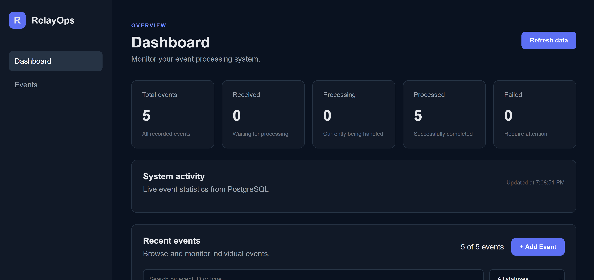
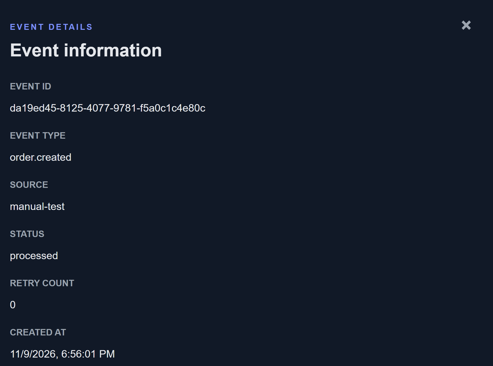
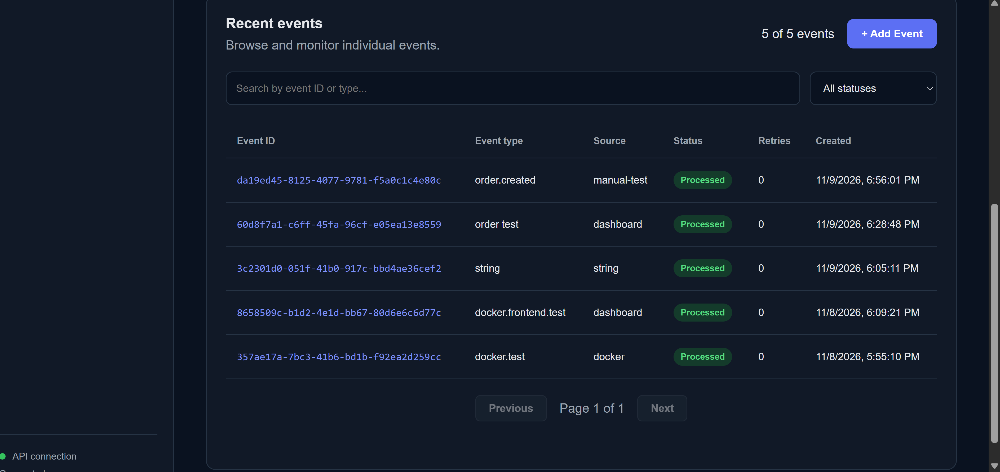

# RelayOps


RelayOps is an event processing platform built with Python, FastAPI, PostgreSQL, and Docker.

It provides an API for receiving events, a background worker for processing them, automatic retries for failed events, and a dashboard for monitoring event activity.

## Features

- REST API for creating and retrieving events
- PostgreSQL database persistence
- Background event processing
- Automatic retry handling
- Configurable retry limits
- Recovery of events stuck in processing
- Event status tracking
- Search and status filtering
- Dashboard with event statistics
- Event details and manual retry controls
- Pagination and automatic dashboard refresh
- Docker Compose environment
- Nginx reverse proxy
- Automated backend tests

## Technology Stack

| Component | Technology |
|---|---|
| Backend | Python, FastAPI |
| Database | PostgreSQL |
| ORM | SQLAlchemy |
| Frontend | HTML, CSS, JavaScript |
| Web server | Nginx |
| Background processing | Python worker |
| Containers | Docker, Docker Compose |
| Testing | Pytest |

## Architecture

RelayOps uses four main services:

1. Frontend: Displays event activity and communicates with the API.
2. API: Accepts requests, validates data, and manages events.
3. Worker: Processes pending events and handles retries.
4. Database: Stores event records and processing information.

### Architecture Diagram


The system uses Docker Compose to run four services:

- Nginx serves the frontend and forwards API requests to FastAPI.
- FastAPI handles event creation, retrieval, status updates, and retry requests.
- PostgreSQL stores events, processing states, and retry information.
- The background worker polls PostgreSQL, claims pending events, processes them, and handles retries.

The frontend communicates with the backend through REST API endpoints. The worker operates independently from incoming API requests.


## Screenshots

### Dashboard


### Event Details


### Event Management



## Getting Started

### Requirements

- Docker Desktop
- Git

### Run with Docker Compose

Clone the repository:

```bash
git clone YOUR_REPOSITORY_URL
cd relayops
```

Create a root `.env` file using `.env.example` as a reference.

Fill in your local PostgreSQL credentials.

Start the application:

```bash
docker compose up --build -d
```

Open the dashboard:

http://localhost:5500

API documentation:

http://localhost:8000/docs

Check container status:

```bash
docker compose ps
```

Stop the application:

```bash
docker compose down
```

Your database volume remains intact when you stop the application this way.


## API Documentation

RelayOps exposes a REST API through FastAPI.

Interactive API documentation is available at:

- Swagger UI: `http://localhost:8000/docs`
- ReDoc: `http://localhost:8000/redoc`

### Endpoints

| Method | Endpoint | Description |
|---|---|---|
| GET | `/health` | Check API health |
| GET | `/events/stats` | Retrieve event statistics |
| POST | `/events` | Create an event |
| GET | `/events` | List events |
| GET | `/events/{event_id}` | Retrieve an event |
| POST | `/events/{event_id}/retry` | Retry a failed event |
| PATCH | `/events/{event_id}/status` | Update event status |

### Create an Event

`POST /events`

Request:

```json
{
  "event_type": "order.created",
  "source": "ecommerce",
  "payload": {
    "order_id": "ORD-1001",
    "customer_id": "CUS-501",
    "total": 149.99
  }
}
```

Response: `201 Created`

```json
{
  "id": "generated-event-uuid",
  "event_type": "order.created",
  "source": "ecommerce",
  "payload": {
    "order_id": "ORD-1001",
    "customer_id": "CUS-501",
    "total": 149.99
  },
  "status": "received",
  "created_at": "2026-11-17T20:00:00Z",
  "retry_count": 0,
  "last_error": null,
  "next_retry_at": null,
  "processing_started_at": null
}
```

### List Events

`GET /events`

Query parameters:

| Parameter | Default | Description |
|---|---|---|
| `status` | None | Filter by event status |
| `skip` | 0 | Number of records to skip |
| `limit` | 20 | Number of records to return, maximum 100 |

Example:

`GET /events?status=processed&skip=0&limit=10`

Supported statuses:

- `received`
- `processing`
- `processed`
- `failed`

### Event Statistics

`GET /events/stats`

Example response:

```json
{
  "total": 10,
  "received": 2,
  "processing": 1,
  "processed": 6,
  "failed": 1
}
```

### Retry an Event

`POST /events/{event_id}/retry`

Only failed events are eligible for manual retry.

A successful retry request:

- Changes status to `received`.
- Resets retry count to zero.
- Clears the previous error.
- Clears the scheduled retry time.
- Clears the processing start time.

### Update Event Status

`PATCH /events/{event_id}/status`

Request:

```json
{
  "status": "processing"
}
```

Allowed transitions:

| Current status | Allowed next statuses |
|---|---|
| received | processing |
| processing | processed, failed |
| failed | processing |
| processed | None |

### Error Responses

| HTTP status | Description |
|---|---|
| 400 | Invalid status, pagination parameters, or status transition |
| 404 | Event not found |
| 422 | Invalid request body |
| 500 | Unexpected internal server error |

Unexpected server errors are logged and return a generic error response.


## Event Lifecycle

Events follow these statuses:

- `received`: Event accepted by the API.
- `processing`: Worker is processing the event.
- `processed`: Event completed successfully.
- `failed`: Event exhausted its retry attempts.

## Testing

The backend test suite uses Pytest.

Run tests from the backend directory:

```bash
python -m pytest -v
```

Current test status: 24 passing tests.

## Project Structure

```text
relayops/
├── backend/
│   ├── tests/
│   ├── main.py
│   ├── worker.py
│   ├── models.py
│   ├── schemas.py
│   ├── database.py
│   ├── logging_config.py
│   ├── requirements.txt
│   └── Dockerfile
├── frontend/
│   ├── index.html
│   ├── style.css
│   ├── app.js
│   └── nginx.conf
├── docker-compose.yml
├── docker-compose.prod.yml
├── .env.example
└── README.md
```

## Security

- Environment files containing credentials are excluded from Git.
- The backend container runs as a non-root user.
- PostgreSQL is not exposed through a public host port in the development Compose configuration.
- Nginx routes frontend API requests to the backend service.

## Project Status

The application currently runs through Docker Compose. The backend test suite passes all 24 tests, and the main event processing workflow has been verified.

Production deployment preparation remains in progress.